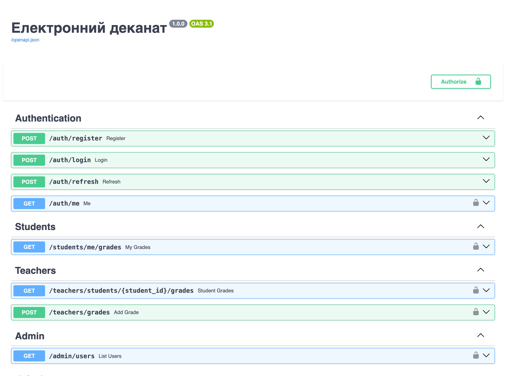
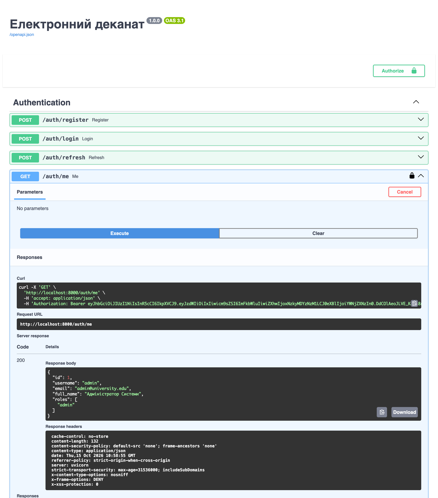
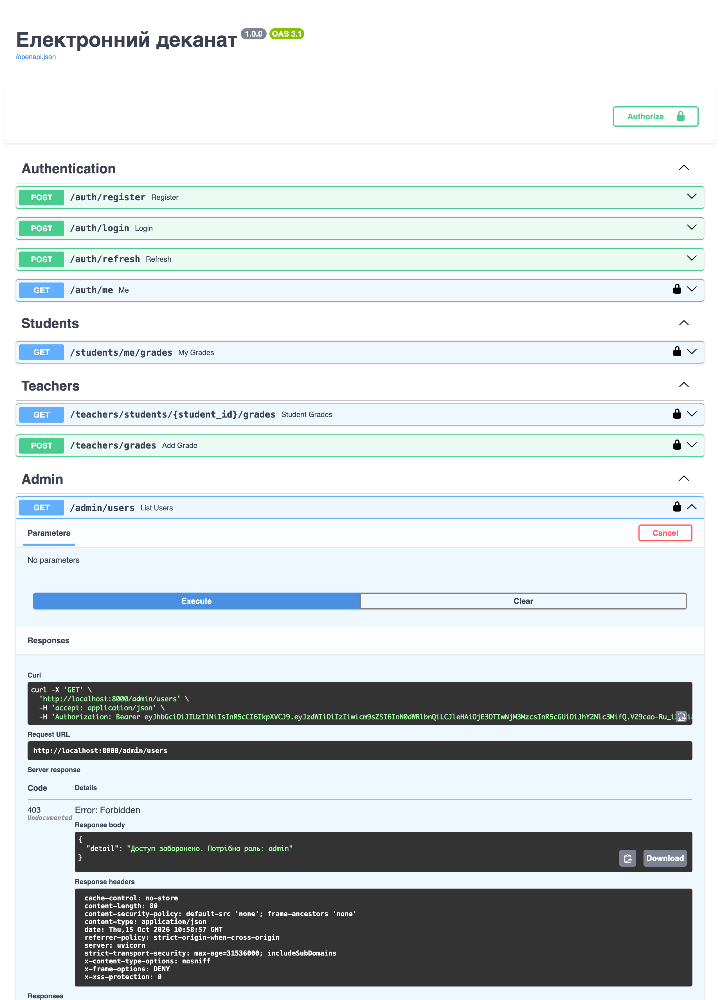
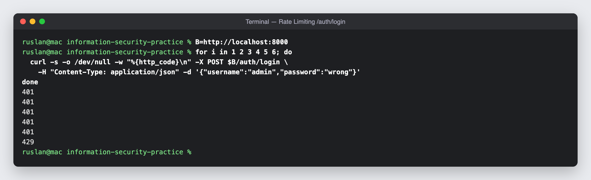
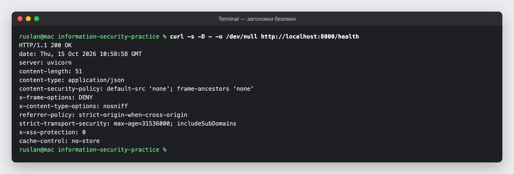

# Електронний деканат — захищений REST API

**Заочні практичні роботи №1 і №2** з дисципліни «Безпека інформаційних систем»

| | |
|---|---|
| Виконав | Козинський Руслан Ярославович |
| Група | Б2F501ЗОФ23 (233з) |
| Курс | 3 |
| Спеціальність | 125 «Кібербезпека» |

REST API системи «Електронний деканат» на **FastAPI + SQLite + JWT + RBAC**. Захист побудовано шарами (Defense in Depth):

1. **Середовище:** ізольований Docker-контейнер, секрети у змінних оточення (`.env` не в Git).
2. **Дані:** модель RBAC «Користувач → Роль → Дозвіл» у БД, ORM SQLAlchemy замість «сирого» SQL, міграції Alembic.
3. **Автентифікація:** паролі зберігаються лише як bcrypt-хеші (cost 12), сувора Pydantic-валідація.
4. **Авторизація:** JWT access/refresh токени, ролі перевіряються за даними з БД (401 ≠ 403).
5. **Веб-рівень:** Security Headers (CSP, HSTS…), CORS allow-list, Rate Limiting, санітизація проти Stored XSS.
6. **Шифрування даних (ЗПР-2):** email і телефон у БД зашифровано Fernet, пошук через сліпий індекс HMAC, зашифровані бекапи.
7. **Аудит і hardening (ЗПР-2):** журнал аудиту за 5W, виявлення Brute Force, non-root контейнер із read-only FS, HTTPS через Nginx, сканування Trivy / pip-audit / Bandit.

## Технології

Python 3.11 · FastAPI 0.111 · SQLAlchemy 2.0 · Alembic 1.13 · Pydantic 2.7 · passlib + bcrypt 4.0.1 · python-jose (HS256) · cryptography (Fernet) · bleach · slowapi · Docker Compose · Nginx (TLS 1.2+)

## Запуск

```bash
git clone https://github.com/Ruslan3874/information-security-practice.git
cd information-security-practice

cp .env.example .env
# заповніть .env: JWT_SECRET_KEY — openssl rand -hex 32;
# ENCRYPTION_KEY і BLIND_INDEX_KEY — python -m scripts.generate_key (або openssl rand -hex 32 для BLIND_INDEX_KEY)
# Збережіть ключі окремо в менеджері паролів: втрата ENCRYPTION_KEY = втрата всіх email.

./scripts/generate_cert.sh               # self-signed сертифікат для https://localhost
docker compose up -d --build
docker compose exec api alembic upgrade head
docker compose exec api python -m app.seed
```

| Адреса | |
|---|---|
| API через Nginx (HTTPS) | https://localhost |
| Swagger UI | https://localhost/docs |
| API напряму (лише з цього комп'ютера) | http://127.0.0.1:8000 |

`http://localhost` перенаправляє на HTTPS (301). Сертифікат self-signed, тому для curl потрібен `-k`.

Повне скидання БД: `docker compose down -v`, далі `docker compose up -d --build`, міграція і seed.

## Ендпоінти та ролі

| Метод | Шлях | Доступ | Примітка |
|---|---|---|---|
| GET | `/` | public | |
| GET | `/health` | public | кількість таблиць у БД |
| POST | `/auth/register` | public | нові користувачі отримують лише роль `student`; ліміт 10/хв |
| POST | `/auth/login` | public | повертає access + refresh token; ліміт 5/хв |
| POST | `/auth/refresh` | власник refresh token | ротація: нова пара токенів |
| GET | `/auth/me` | будь-який автентифікований | |
| GET | `/students/me/grades` | student | лише власні оцінки (id береться з токена, не з URL) |
| GET | `/teachers/students/{student_id}/grades` | teacher, admin | |
| POST | `/teachers/grades` | teacher, admin | оцінка 0–100, коментар санітизується, `assigned_by` = хто виставив |
| GET | `/admin/users` | admin | |
| GET | `/admin/audit-log` | admin | журнал аудиту з фільтрами `action`, `username`, `ip`, `status`, `hours` і пагінацією; сам перегляд теж логується |
| GET | `/admin/security-stats` | admin | лічильники безпекових подій за `hours` (невдалі входи, алерти Brute Force, top IP) |

### Матриця RBAC (принцип мінімальних привілеїв)

| Дозвіл | admin | teacher | student |
|---|:-:|:-:|:-:|
| read_grades | ✔ | ✔ | ✔ |
| edit_grades | ✔ | ✔ | — |
| read_schedule | ✔ | ✔ | ✔ |
| manage_users, manage_groups, manage_subjects | ✔ | — | — |
| view_reports | ✔ | ✔ | — |

### Тестові облікові записи

Створюються командою `python -m app.seed`. Паролі є лише в [`app/seed.py`](app/seed.py).

| Логін | Роль |
|---|---|
| `admin` | admin |
| `teacher01` | teacher |
| `student01` | student (група КН-31) |

## Безпека

Повний звіт аудиту безпеки: **[SECURITY_AUDIT.md](SECURITY_AUDIT.md)** — інвентаризація активів, STRIDE, матриця ризиків, знахідки з рекомендаціями, чеклист OWASP Top 10, результати сканування і мінітестів, KPI та план покращень.

Перевірка конфігурації і залежностей перед здачею або деплоєм (exit 1, якщо є FAIL):

```bash
./scripts/security_check.sh | tee reports/security_check.txt
```

12 мінітестів на вразливості проти власного стенду:

```bash
./scripts/pentest_mini.sh | tee reports/pentest_mini.md              # через Nginx
BASE=http://localhost:8000 ./scripts/pentest_mini.sh                 # напряму в API
```

Тест Brute Force у `pentest_mini.sh` блокує вхід з вашої IP на 5 хвилин.

| Звіт | Що всередині |
|---|---|
| [`reports/security_check.txt`](reports/security_check.txt) | `SECURITY CHECK PASSED` (FAIL 0, WARN 2) |
| [`reports/pentest_mini.md`](reports/pentest_mini.md) | 12/12 ✅ через Nginx ([напряму](reports/pentest_mini_direct.md) — теж 12/12) |
| [`reports/trivy.txt`](reports/trivy.txt) | сканування образу (HIGH, CRITICAL) |
| [`reports/pip-audit.txt`](reports/pip-audit.txt) | вразливості Python-залежностей |
| [`reports/bandit.txt`](reports/bandit.txt) | SAST коду `app/` — 0 проблем |

Шифрування й бекапи:

```bash
docker compose exec api python -m scripts.backup_db                       # зашифрований бекап у data/backups/
docker compose exec api sh -c 'python -m scripts.restore_db $(ls -t data/backups/*.enc | head -1)'   # тестове відновлення
```

## Фінальна перевірка (ЗПР-1)

Перевірку виконано на чистій БД (`docker compose down -v` → `up -d --build` → міграція → seed) скриптом [`scripts/final_check.sh`](scripts/final_check.sh):

```bash
bash scripts/final_check.sh
```

| № | Сценарій | Запит | Очікування | Фактичний результат |
|---|---|---|---|---|
| 1 | Health | `GET /health` | 200, tables: 8 | ✅ 200, `"tables":8` |
| 2 | Реєстрація (успіх) | `POST /auth/register`, валідні дані | 201, без password_hash | ✅ 201, password_hash у відповіді немає |
| 3 | Дублікат | той самий username ще раз | 409 | ✅ 409 |
| 4 | Слабкий пароль | `"password":"password"` | 422 | ✅ 422 |
| 5 | XSS в імені | `"full_name":"<script>alert(1)</script>"` | 422 | ✅ 422 |
| 6 | Логін (успіх) | `POST /auth/login` admin | 200, access_token + refresh_token | ✅ 200, обидва токени |
| 7 | Невірний пароль | `POST /auth/login`, `"password":"wrong"` | 401 «Невірний логін або пароль» | ✅ 401 «Невірний логін або пароль» |
| 8 | Без токена | `GET /auth/me` | 401 | ✅ 401 |
| 9 | Підроблений токен | `GET /auth/me`, `Bearer abc.def.ghi` | 401 | ✅ 401 |
| 10 | Refresh замість access | `GET /auth/me`, `Bearer $RT` | 401 | ✅ 401 |
| 11 | Оновлення токенів | `POST /auth/refresh` | 200 | ✅ 200 |
| 12 | Свої оцінки | `GET /students/me/grades`, `$ST` | 200 | ✅ 200 |
| 13 | Студент → admin | `GET /admin/users`, `$ST` | 403 | ✅ 403 |
| 14 | Викладач → admin | `GET /admin/users`, `$TT` | 403 | ✅ 403 |
| 15 | Адмін → admin | `GET /admin/users`, `$AT` | 200 | ✅ 200 |
| 16 | Оцінка поза діапазоном | `POST /teachers/grades`, `"grade":9999`, `$TT` | 422 | ✅ 422 |
| 17 | Stored XSS у коментарі | `POST /teachers/grades`, comment зі `<script>`, `$TT` | 201, тег вирізано | ✅ 201, `"comment":"alert(document.cookie)Добре"` |
| 18 | Security Headers | `curl -s -D - -o /dev/null $B/health` | CSP, X-Frame-Options, nosniff, HSTS, Referrer-Policy | ✅ усі 5 (а також `X-XSS-Protection: 0`, `Cache-Control: no-store`) |
| 19 | CORS чужий домен | `OPTIONS /auth/login`, `Origin: http://evil.example` | 400, без access-control-allow-origin | ✅ 400, заголовка немає |
| 20 | Rate Limiting | 6 × `POST /auth/login` за хвилину | 429 | ✅ 401 ×5, потім 429 |

**Підсумок: 20 / 20.**

Додатково перевірено: preflight з `Origin: http://localhost:3000` → 200 і `access-control-allow-origin: http://localhost:3000`; Swagger UI на `/docs` відображається з окремою CSP без помилок у консолі.

## Модель загроз STRIDE

| Загроза | Приклад атаки | Контрзахід у коді | Що можна покращити |
|---|---|---|---|
| **S**poofing (підміна особи) | вгадування пароля, credential stuffing, підроблений токен | bcrypt-хеші ([`security.py`](app/security.py)); підпис JWT і перевірка `exp` ([`jwt_handler.py`](app/auth/jwt_handler.py)); однакова 401 для невірного логіна і пароля (захист від username enumeration); ліміт 5 логінів/хв | MFA; блокування акаунта після N невдалих спроб; RS256 замість спільного секрету HS256 |
| **T**ampering (підробка даних) | зміна payload токена, `alg: none`, SQL Injection, Stored XSS | підпис HS256 і `algorithms=[ALGORITHM]` списком; ORM SQLAlchemy (параметризовані запити); Pydantic: allow-list для імені, діапазон 0–100 для оцінки; bleach вирізає теги з коментаря; CSP `default-src 'none'` | RS256 з ротацією ключів; WAF перед API |
| **R**epudiation (відмова від дій) | викладач заперечує, що виставив оцінку | поле `assigned_by` у `grades` фіксує, хто виставив оцінку | окремий журнал аудиту (хто, що, коли, з якої IP) для всіх змін |
| **I**nformation Disclosure (витік даних) | хеш пароля у відповіді, IDOR, читання payload JWT | `UserResponse` без `password_hash`; студент бачить лише власні оцінки (id з токена); у JWT немає персональних даних; секрет у `.env`; `nosniff`, `Cache-Control: no-store`, `X-Frame-Options: DENY` | HTTPS/TLS на reverse proxy (зараз HSTS діє лише за HTTPS); менеджер секретів замість `.env` |
| **D**enial of Service | масовий перебір логінів і реєстрацій | slowapi: 5/хв на `/auth/login`, 10/хв на `/auth/register`; обмеження довжини полів (пароль ≤ 72, коментар ≤ 500) | спільне сховище лімітів у Redis (зараз ліміти в пам'яті одного процесу); ліміти на всі ендпоінти; WAF |
| **E**levation of Privilege | студент викликає admin-ендпоінт; refresh token замість access | `require_role` бере ролі з БД, а не з токена (відкликання ролі діє одразу); нові користувачі отримують лише `student` (PoLP); `get_current_user` перевіряє `type == "access"` | перевірка на рівні дозволів (`edit_grades`), а не лише ролей; Redis-blacklist для відкликаних токенів; HttpOnly cookie + CSRF-токен, якщо токен переїде в cookie |

## Скріншоти

### Swagger UI з усіма групами ендпоінтів


### Після Authorize: GET /auth/me → 200


### Студент → GET /admin/users → 403


### Rate Limiting: 429 після 5 спроб


### Заголовки безпеки у відповіді /health


## Структура проєкту

```
app/
├── main.py                  # точка входу, middleware, роутери
├── config.py                # SECRET_KEY, терміни дії токенів, CORS
├── database.py              # engine, сесія, Base, get_db
├── models.py                # 7 моделей (з AuditLog) + 2 зв'язкові таблиці
├── schemas.py               # Pydantic-схеми
├── security.py              # bcrypt: hash / verify
├── seed.py                  # ролі, дозволи, тестові користувачі
├── auth/                    # jwt_handler, dependencies, router
├── audit/                   # logger, middleware, detector, router (ЗПР-2)
├── crypto/                  # key_manager, encryption: Fernet і сліпий індекс (ЗПР-2)
├── routes/                  # students, teachers, admin
├── middleware/              # security_headers, rate_limiter
└── validators/sanitizer.py  # bleach
alembic/versions/            # 4 міграції: таблиці, шифрування PII, audit_log
nginx/nginx.conf             # HTTPS, редирект 80 → 443, limit_req (ЗПР-2)
scripts/
├── final_check.sh           # 20 сценаріїв фінальної перевірки (ЗПР-1)
├── generate_key.py          # ключі ENCRYPTION_KEY і BLIND_INDEX_KEY
├── migrate_encrypt.py       # шифрування наявних email
├── backup_db.py / restore_db.py   # зашифрований бекап і тестове відновлення
├── generate_cert.sh         # self-signed сертифікат
├── security_check.sh        # перевірка конфігурації і залежностей
└── pentest_mini.sh          # 12 мінітестів на вразливості
reports/                     # звіти сканерів і мінітестів
SECURITY_AUDIT.md            # звіт аудиту безпеки (ЗПР-2)
docs/screenshots/            # скріншоти для README
```
